<div align="center">



# ⚡ Awesome-Cloud-Native-Networking-EBPF

### 🚀 Curated Index of Cloud-Native Networking, eBPF Dataplanes, Kubernetes CNIs & Observability

<p align="center">
<a href="https://github.com/ishandutta2007/Awesome-Awesome-Awesome"></a><a href="https://discord.gg/jc4xtF58Ve"></a>
<a href="https://github.com/ishandutta2007/Awesome-Cloud-Native-Networking-EBPF/stargazers"></a>
<a href="https://github.com/ishandutta2007/Awesome-Cloud-Native-Networking-EBPF/network/members"></a>
<a href="https://github.com/ishandutta2007/Awesome-Cloud-Native-Networking-EBPF/issues"></a>
<a href="https://github.com/ishandutta2007/Awesome-Cloud-Native-Networking-EBPF/pulls"></a>
<a href="https://github.com/ishandutta2007"></a>
</p>

<p align="center">
  <b>A comprehensive, SEO-optimized guide for Platform Engineers, SREs, and Cloud Architects</b><br>
  Explore high-performance <b>eBPF dataplanes</b>, <b>Kubernetes Container Network Interfaces (CNI)</b>, <b>BGP routing</b>, <b>service mesh integration</b>, and <b>runtime zero-trust observability</b>.
</p>

📅 **Last updated:** October 2026 | 🤝 **Contributions:** PRs & issues warmly welcomed!

</div>

---

## 📖 Table of Contents

- [🌐 Sector Overview & Market Dynamics](#-sector-overview--market-dynamics)
- [☁️ SaaS & Hosted Commercial Platforms](#️-saas--hosted-commercial-platforms)
- [🛠️ Open-Source GitHub Projects (Ranked by Stars)](#️-open-source-github-projects-ranked-by-stars)
- [🌟 Star History](#-star-history)
- [🤝 How to Contribute](#-how-to-contribute)
- [💖 Support](#-support)
- [⚠️ Disclaimer & Architectural Guidance](#️-disclaimer--architectural-guidance)

---

## 🌐 Sector Overview & Market Dynamics

The global cloud-native networking and container networking market is estimated at approximately **$3.5B to $7B** (with the broader Cloud-Native Network Functions / CNF market exceeding $25B and projected to surpass $70B by the 2030s at an estimated ~20% CAGR), while specialized kernel-level eBPF networking and runtime security constitutes an emerging high-velocity sub-segment surging towards $5B+. 

The sector is **moderately fragmented and dual-structured**:
- **Commoditized Hyperscaler Layer**: Public cloud providers (AWS VPC CNI, Azure CNI, GCP GKE Dataplane V2) provide default pod IP address management (IPAM) and VPC network fabric integration.
- **High-Velocity Innovation Layer**: Advanced multi-cluster routing, kernel bypass, L7 flow filtering, service mesh acceleration, and zero-trust policies are driven by community-driven open-source software—anchored prominently by the CNCF graduated **Cilium** project and **Calico** enterprise ecosystems—alongside consolidating enterprise network vendors (Cisco, Broadcom).

---

## ☁️ SaaS & Hosted Commercial Platforms

Below is a comparison of leading enterprise and hosted Kubernetes networking platforms, ordered by parent organization valuation / market cap:

| Product | Vendor / Company | Valuation / Revenue | Starting Pricing | Free Tier / Trial Limits | Description |
| :--- | :--- | :--- | :--- | :--- | :--- |
| **[Azure CNI](https://azure.microsoft.com/)** | 🏢 Microsoft | ~$3.1T Market Cap / ~$245B Annual Revenue | **$0.00** (Included with AKS; AKS Standard tier starts at $0.10/cluster/hour, ~$73/month) | **Free tier available**: AKS Free control plane tier covers up to 1,000 nodes at $0/month (standard Azure VM compute/VNet egress resource usage charged separately). | 🌐 **Native Azure CNI** with deep VNet integration. Azure CNI Overlay provides overlay networking without consuming host VNet IP space. Default networking for AKS clusters. |
| **[AWS VPC CNI](https://aws.amazon.com/)** | 🏢 Amazon (AWS) | ~$1.9T Market Cap / ~$105B+ AWS Annual Revenue Run Rate | **$0.00** (Software is free; EKS managed control plane starts at $0.10/cluster/hour, ~$72/month) | **Trial/Credit tier**: No permanent free control plane tier; eligible for AWS Free Tier $100–$200 promotional sign-up credits (expires in 6 months; standard EC2/VPC infrastructure billable). | ⚡ **Native AWS CNI** assigning VPC IP addresses directly to pods. Default for EKS—pods are first-class VPC citizens with native security group and route table integration. |
| **[VMware NSX](https://www.vmware.com/)** | 🏢 Broadcom | ~$800B Market Cap / ~$50B+ Annual Revenue | Subscriptions start per-core via VMware Cloud Foundation (VCF) / vDefend bundles (~16-core minimum per CPU socket) | **60-day free trial**: Full evaluation mode for 60 days across NSX Manager and container plugins; reverts to restricted/read-only mode upon expiration. | 🛡️ **Enterprise network virtualization and security platform** with container networking via NSX Container Plugin (NCP). Deep integration with vSphere, VMware Cloud Foundation, and Tanzu. |
| **[Isovalent Enterprise Cilium](https://pages.solo.io/rs/132-VJP-402/images/Service_mesh_buyers_guide.pdf?version=0#7#3)** | 🏢 Cisco (Isovalent) | ~$230B Market Cap / ~$54B Annual Revenue (Isovalent acquired for ~$650M) | Starting tier estimated at ~$1,000/node/year (unit-based licensing via Cisco / Cloud Marketplaces) | **Interactive labs / Custom trial**: Free hands-on access via Isovalent Interactive Labs (unlimited, zero-cost online browser labs); custom enterprise evaluation licenses available upon request. | 🚀 **Enterprise edition of Cilium** featuring 24/7 SLA support, hardened compliance binaries, Hubble Enterprise, and Cluster Mesh for cross-cloud failover and transparent multi-cluster service discovery. |
| **[Calico Cloud](https://docs.tigera.io/calico/latest/about/product-comparison)** | 🏢 Tigera | ~$100M–$150M Valuation (~$25M+ ARR) | Pay-as-you-go starting at **$0.025/vCPU-hour** (~$0.05–$0.08/node-hour or ~$350/node/year) | **Free tier available**: Permanent Free Tier covers 1 Kubernetes cluster (requires Calico Open Source 3.30+, includes Dynamic Service Graph and view-only policy board); also offers a 14-day full-feature trial (no credit card required). | ☁️ **Fully managed SaaS platform for Kubernetes networking and security**. Delivers workload threat detection, dynamic service graph visualization, and microsegmentation policy without running local management overhead. |
| **[Calico Enterprise](https://docs.tigera.io/calico/latest/about/calico-product-editions)** | 🏢 Tigera | ~$100M–$150M Valuation (~$25M+ ARR) | Annual subscriptions based on node/vCPU count via private marketplace custom offers | **Custom evaluation trial**: Multi-week trial license provided on request via Tigera technical sales; alternative hands-on trial available via Calico Cloud 14-day trial. | 🔒 **Self-managed enterprise platform** extending Calico Open Source with hierarchical tiered network policy, DNS/FQDN rules, policy recommendations, SIEM streaming, workload WAF, and PCI/SOC2 compliance reporting. |

---

## 🛠️ Open-Source GitHub Projects (Ranked by Stars)

Every major open-source cloud-native networking repository, kernel dataplane toolkit, and observability framework, sorted in **descending order by GitHub stargazers**:

### 1. [Cilium](https://github.com/cilium/cilium) [](https://github.com/cilium/cilium/stargazers)
- 🐝 **Description**: eBPF-based Networking, Observability, and Security for Kubernetes.
- 💡 **Core Highlights**: CNCF Graduated project. De facto industry standard for cloud-native eBPF networking. Bypasses `kube-proxy` via eBPF sockops/XDP, enforces identity-aware L3/L4/L7 policies, provides ClusterIP load balancing, multi-pool IPAM, and native WireGuard/IPsec encryption.
- 🎯 **Best For**: Modern Kubernetes clusters (EKS, AKS, GKE Dataplane V2), high-density microservices, and high-throughput networking.

### 2. [BCC (BPF Compiler Collection)](https://github.com/iovisor/bcc) [](https://github.com/iovisor/bcc/stargazers)
- 🔧 **Description**: Toolkit for creating efficient kernel tracing, manipulation, and network instrumentation programs using extended BPF.
- 💡 **Core Highlights**: Foundational collection of tools and Python/Lua/C++ frontends for analyzing socket connections, TCP lifecycle, network latency, and low-level Linux kernel events.
- 🎯 **Best For**: Kernel-level network debugging, systems programming, and performance analysis.

### 3. [bpftrace](https://github.com/iovisor/bpftrace) [](https://github.com/iovisor/bpftrace/stargazers)
- 🔬 **Description**: High-level tracing language for Linux enhanced Berkeley Packet Filter (eBPF).
- 💡 **Core Highlights**: Inspired by awk and DTrace; provides one-liners and scripts for diagnosing network packet drops, socket connections, TCP retransmissions, and CNI performance bottlenecks in production.
- 🎯 **Best For**: Ad-hoc production network troubleshooting and latency profiling.

### 4. [Flannel](https://github.com/flannel-io/flannel) [](https://github.com/flannel-io/flannel/stargazers)
- 🧵 **Description**: Simple and easy-to-configure container network interface (CNI) fabric for Kubernetes.
- 💡 **Core Highlights**: Configures a layer 3 network fabric using VXLAN, host-gw, or WireGuard. Extremely lightweight with minimal memory and CPU footprints.
- 🎯 **Best For**: Edge computing (K3s), beginner learning clusters, testing environments, and simple clusters where Kubernetes NetworkPolicy enforcement is handled out-of-band.

### 5. [Falco](https://github.com/falcosecurity/falco) [](https://github.com/falcosecurity/falco/stargazers)
- 🦅 **Description**: Cloud-native runtime security and network anomaly detection engine (CNCF Graduated).
- 💡 **Core Highlights**: Leverages eBPF probes and modern kernel drivers to monitor unexpected network socket events, outbound connections to malicious IPs, port scanning, and suspicious container traffic patterns.
- 🎯 **Best For**: Runtime container security, network threat detection, and SOC2/PCI-DSS compliance.

### 6. [Sysdig OSS](https://github.com/draios/sysdig) [](https://github.com/draios/sysdig/stargazers)
- 🔍 **Description**: Universal system visibility tool and packet sniffer with native container and Kubernetes support.
- 💡 **Core Highlights**: Captures system calls and networking events at the OS kernel level via eBPF; enables deep packet and socket stream decoding with Lua scriptable filters (chisels).
- 🎯 **Best For**: Deep container forensic investigations and post-mortem network analysis.

### 7. [cilium/ebpf](https://github.com/cilium/ebpf) [](https://github.com/cilium/ebpf/stargazers)
- 📦 **Description**: Pure Go library to read, modify, and load eBPF programs and maps into the Linux kernel without CGo dependencies.
- 💡 **Core Highlights**: Enables Go developers to build high-performance cloud-native networking tools, custom XDP firewalls, TC (traffic control) filters, and socket programs.
- 🎯 **Best For**: Building custom Go-based CNIs, network controllers, and cloud-native observability agents.

### 8. [Calico Open Source](https://github.com/projectcalico/calico) [](https://github.com/projectcalico/calico/stargazers)
- 🐯 **Description**: Cloud-native networking, IP address management (IPAM), and network security for containers, VMs, and bare-metal workloads.
- 💡 **Core Highlights**: The enterprise standard for BGP-routed cloud-native networks. Features multiple pluggable dataplanes (eBPF, iptables, Windows HNS, and VPP), wire-speed WireGuard encryption, and fine-grained Kubernetes NetworkPolicy enforcement.
- 🎯 **Best For**: On-premises enterprise Kubernetes, OpenShift, telco 5G CNFs, and environments requiring native top-of-rack BGP peering.

### 9. [Weave Net](https://github.com/weaveworks/weave) [](https://github.com/weaveworks/weave/stargazers)
- 🕸️ **Description**: Simple, resilient multi-host network overlay for Docker and Kubernetes.
- 💡 **Core Highlights**: Historically pioneering mesh network overlay with automated IPAM and packet encryption.
- ⚠️ **Status**: Project is archived/in maintenance mode; not recommended for new greenfield production deployments.

### 10. [Pixie](https://github.com/pixie-io/pixie) [](https://github.com/pixie-io/pixie/stargazers)
- ✨ **Description**: Open-source, no-instrumentation eBPF observability platform for Kubernetes.
- 💡 **Core Highlights**: Automatically tracks full-body HTTP/gRPC/DNS requests, network latency, and service maps with zero manual application instrumentation.
- 🎯 **Best For**: Real-time network debugging, automatic distributed tracing, and protocol inspection.

### 11. [Tetragon](https://github.com/cilium/tetragon) [](https://github.com/cilium/tetragon/stargazers)
- 🛡️ **Description**: eBPF-based Security Observability & Real-Time Runtime Enforcement (Cilium sub-project).
- 💡 **Core Highlights**: Operates directly in the Linux kernel to observe and enforce process execution, file integrity, network namespace boundaries, and socket operations before malicious packets leave the host.
- 🎯 **Best For**: Kernel-level zero-trust enforcement, network perimeter lockdown, and real-time incident containment.

### 12. [Hubble](https://github.com/cilium/hubble) [](https://github.com/cilium/hubble/stargazers)
- 🔭 **Description**: Distributed networking and security observability platform built on Cilium and eBPF.
- 💡 **Core Highlights**: Provides high-resolution flow logging, dynamic dependency service maps, Prometheus metrics for TCP latency and DNS resolution times, and interactive CLI/UI interfaces.
- 🎯 **Best For**: Visualizing Kubernetes pod communication flows, troubleshooting DNS degradation, and auditing policy drops.

### 13. [Multus CNI](https://github.com/k8snetworkplumbingwg/multus-cni) [](https://github.com/k8snetworkplumbingwg/multus-cni/stargazers)
- 🔌 **Description**: Multi-homed CNI meta-plugin attaching multiple network interfaces to a single Kubernetes pod.
- 💡 **Core Highlights**: Bridges different CNI plugins together (e.g., pairing Cilium/Calico for default cluster networking with SR-IOV or Macvlan for high-throughput secondary data interfaces).
- 🎯 **Best For**: Telco 5G core workloads, AI/ML training clusters requiring dedicated RoCE/InfiniBand NICs, and network function virtualization (VNF/CNF).

### 14. [libbpf](https://github.com/libbpf/libbpf) [](https://github.com/libbpf/libbpf/stargazers)
- 📚 **Description**: Upstream Linux kernel C library for loading and interacting with eBPF programs with BPF CO-RE (Compile Once – Run Everywhere).
- 💡 **Core Highlights**: The official upstream standard for modern, portable kernel programs, powering state-of-the-art packet processing and network monitoring daemons across all Linux distributions.
- 🎯 **Best For**: Systems developers engineering kernel-level networking and high-performance packet dataplanes.

### 15. [Kube-Router](https://github.com/cloudnativelabs/kube-router) [](https://github.com/cloudnativelabs/kube-router/stargazers)
- 🚦 **Description**: Lean, all-in-one Kubernetes networking solution providing BGP-based routing, IPVS service proxying, and policy enforcement.
- 💡 **Core Highlights**: Combines pod networking with high-performance Linux IPVS (IP Virtual Server) for lightning-fast cluster IP load balancing and standard BGP router peering without external sidecars.
- 🎯 **Best For**: Bare-metal clusters requiring direct BGP peering with enterprise switches and high-speed IPVS proxying.

### 16. [Antrea](https://github.com/antrea-io/antrea) [](https://github.com/antrea-io/antrea/stargazers)
- 🌉 **Description**: Kubernetes networking and security provider built on Open vSwitch (OVS).
- 💡 **Core Highlights**: CNCF Incubating project. Delivers uniform networking across Linux and Windows nodes, multi-cluster interconnects, tiered network policies, WireGuard encryption, and optional native eBPF datapaths.
- 🎯 **Best For**: VMware Tanzu environments, hybrid Linux/Windows clusters, and enterprise OVS infrastructures.

### 17. [OVN-Kubernetes](https://github.com/ovn-org/ovn-kubernetes) [](https://github.com/ovn-org/ovn-kubernetes/stargazers)
- 🏛️ **Description**: Open Virtual Network (OVN) and Open vSwitch (OVS) based Kubernetes CNI provider.
- 💡 **Core Highlights**: The default network provider for Red Hat OpenShift. Implements distributed virtual routing, distributed access control lists (ACLs), egress IP assignment, and native gateway load balancing.
- 🎯 **Best For**: Red Hat OpenShift, OpenStack-integrated clouds, and large-scale enterprise SDN fabrics.

### 18. [SR-IOV CNI](https://github.com/k8snetworkplumbingwg/sriov-cni) [](https://github.com/k8snetworkplumbingwg/sriov-cni/stargazers)
- ⚡ **Description**: Single Root I/O Virtualization (SR-IOV) network device plugin and CNI.
- 💡 **Core Highlights**: Directly allocates hardware Virtual Functions (VFs) from high-speed network adapters (Mellanox, Intel) into container namespaces for near-zero latency and line-rate throughput.
- 🎯 **Best For**: High-frequency trading (HFT), high-throughput AI/ML workloads, and low-latency NFV telecom workloads.

---

## 🌟 Star History

[](https://star-history.dera.page/#ishandutta2007/Awesome-Cloud-Native-Networking-EBPF&type=date&legend=top-left)

---

## 🤝 How to Contribute

Contributions are what make the open-source and cloud-native community such an incredible place to build!

1. 🍴 **Fork the repo** to your GitHub account.
2. 🌿 **Create a feature branch**:
   ```bash
   git checkout -b feature/add-new-project
   ```
3. 📝 **Add or update entries** in `README.md` (maintaining the alphabetical/ranking standards, pricing columns, free tier details, and live stargazer badges).
4. 🚀 **Commit your changes**:
   ```bash
   git commit -m "feat: add NewProject to open-source eBPF section"
   ```
5. 📬 **Push to your branch & open a Pull Request** with a brief summary of the changes.

---

## 💖 Support

Thank you for exploring and supporting **Awesome-Cloud-Native-Networking-EBPF**! 

If this curated ecosystem guide helped you navigate Kubernetes CNIs, eBPF dataplanes, or cloud-native network architectures, please consider:
- ⭐ **Starring this repository** on GitHub to amplify its reach!
- 🍴 **Forking and sharing** it with your fellow DevOps, SRE, and platform engineering teams.
- ☕ **Buying a coffee & sponsoring the project** via the [GitHub Sponsor Dashboard](https://github.com/sponsors/ishandutta2007) to help sustain maintenance and updates!

---

## ⚠️ Disclaimer & Architectural Guidance

- 📋 This is an independent, **community-curated list** created for informational, educational, and architectural evaluation purposes.
- 🔒 **CNI & Kernel Security**: All cloud-native networking tools handling cluster traffic must implement rigorous network policies and defense-in-depth security best practices.
- 🚀 **Open-Source CNI Maturity**: Open-source eBPF and CNI solutions are enterprise-grade and power the world's largest production environments. Cilium represents over 60% of modern CNI deployments (powering GKE Dataplane V2 and AKS), while Calico secures millions of enterprise nodes.
- ⚖️ **Architectural Trade-Offs**:
  - **Cilium**: Chosen for eBPF-native kernel bypass, L7 application-aware policies, Hubble visibility, and integrated service mesh acceleration.
  - **Calico**: Chosen for mature BGP peering with on-premises switches, high-throughput WireGuard encryption, and multi-dataplane flexibility.
  - **Flannel**: Ideal for lightweight edge topologies and learning clusters, but requires pairing with policy controllers for zero-trust workloads.
  - **Weave Net**: Retained for historical reference; legacy clusters should migrate towards Cilium or Calico.
- 🐧 **Kernel Compatibility**: Modern eBPF features require Linux kernel 5.4+ (recommended 5.10+ or 6.x) for full BPF CO-RE and advanced XDP offloading capabilities.

---

<div align="center">
  <b>Built with ❤️ for platform engineers, SREs, and architects building resilient cloud-native networking systems.</b><br>
  <i>Let's make Cloud-Native Networking &amp; eBPF more open, observable, and lightning-fast!</i>
</div>
